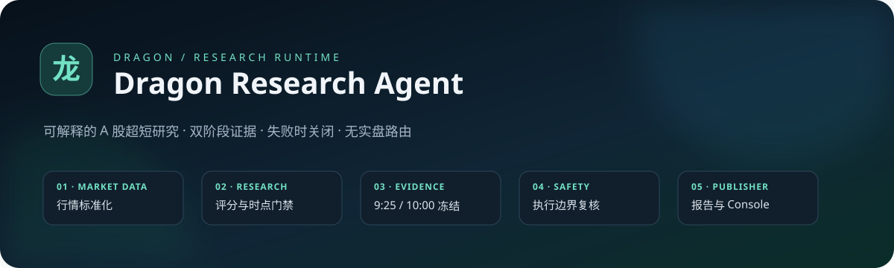

<p align="center">
  
</p>

<p align="center">
  <a href="https://github.com/hehcodeking/dragon-research-agent/actions/workflows/tests.yml"></a>
  
  
  
  <a href="LICENSE"></a>
</p>

<p align="center"><strong>把竞价、量能、换手与昨日涨停结构，变成一条可解释、可审计、失败时自动关闭的 Agent 研究流水线。</strong></p>

<p align="center">An auditable multi-agent workspace for A-share momentum research, built for learning and extension.</p>

# 龙头研究 Agent

一个可运行、可审计、适合学习的本地 Python 多阶段 Agent：同花顺数据接入、竞价/盘中选股观察、龙头规则评分、V2 证据冻结、风险复核、日线回放和模拟账本。Python 3.11+，运行时仅用标准库，无需安装依赖。源码、测试、配置、Agent Console 和离线交互工作台都包含在此目录。

| 数据 Agent | 研究 Agent | 证据 Agent | 安全 Agent | 发布 Agent |
| --- | --- | --- | --- | --- |
| 标准化真实/导入行情 | 排序与时点门禁 | 冻结 9:25 / 10:00 证据 | 验证不可下单不变量 | 生成 JSON 与三页工作台 |

**不能保证稳定盈利。** 这是第一版研究和模拟系统，未训练或验证有效投资优势，也不是陈小群、92 科比、紫阳东路的私有交易体系复刻。它把龙头、题材、情绪、承接等思路转成公开可审查的规则。8% 为回撤停机触发线，跳空、跌停和 T+1 会使实际亏损越过该线。

## 现在可以使用

macOS 双击 **run.command**，或在本目录执行：

```bash
./run.command demo --open
```

会生成 `reports/demo/index.html`（龙头研究、风险与日线回放）、`reports/demo/realtime.html`（实时选股观察台）和 `reports/demo/agent.html`（Agent 执行链路与安全边界）。三页均为自包含 HTML，可离线打开；可搜索、筛选、展开评分依据并导出 JSON。演示股票、行情、额外字段与回放结果全部是**合成数据**，不代表真实收益。演示同时生成快照、历史数组和实时特征示例，方便替换为经核实的数据。

## Agent 架构

实时命令由五个专职 Agent 顺序协作：Market Data → Research → V2 Evidence → Safety → Publisher。每一步通过结构化 `AgentContext` 交换结果，并写入不含敏感数据的 `AgentEvent`。任一阶段失败都会停止发布；Safety Agent 会验证实时研究结果始终不能成为订单。

```bash
./run.command agent-architecture
```

详细数据流、扩展约定和 Mermaid 图见 [Agent 架构说明](docs/architecture.md)，最小自定义实现见 [examples/custom_agent.py](examples/custom_agent.py)。新手可从 [快速开始](docs/quickstart.md) 进入；准备上传公开仓库前请阅读 [GitHub 发布说明](docs/github-release.md)、[贡献说明](CONTRIBUTING.md) 和 [安全策略](SECURITY.md)。

`run.command` 优先使用这台电脑的 Codex Python，其他机器可安装 Python 3.11+ 后使用 `python3 -m dragon_agent ...`。也可设置 `DRAGON_PYTHON` 指定解释器。下面的命令在当前电脑都可把 `python3 -m dragon_agent` 换成 `./run.command`。

## 实时选股

### V2.0：9:25 竞价评分 → 10:00 盘中确认

已纳入你提供的《龙头股量化打分模型 V2.0》，保留原文于 `docs/source/leader-model-v2.md`。竞价版 23 项、盘中版 30 项，各自权重合计 100 分；完整计分与边界约定见 [V2 模型说明](docs/model-v2.md)。观察台新增独立双阶段表、分组得分、证据来源、覆盖率、分差和 10 条一票否决。

持续采集时，在上海时间 **09:25–09:30 前**冻结首次就绪竞价记录，在 **10:00–10:05 前**冻结首次盘中记录。实际捕获时刻会展示；错过窗口不会用下午行情倒填。记录保存于 `reports/realtime/v2-state.json`，当天重启继续使用，换日自动隔离。两个模型权重不同，分差只作研究提示；证据不齐或存在否决时不生成强弱转变结论。

目前真实接口能直接补充的 V2 数值项是“竞价成交额 / 昨日成交额”。其余定性或需要完整分时序列的项目不自动猜测：主动带动、分歧承接、9:20–9:25 趋势、真实回撤修复、首次封板与回封过程等需要附来源、观测时间、可用时间的独立证据。风险未复核不默认给满分，缺失不按剩余权重重新放大。

可生成空白证据表及包含所有可选值的规则目录，在观察窗口开始前准备好证据来源，并随真实观察更新：

```bash
./run.command model-v2-template --symbols 600519.SH,000001.SZ --out my-assessments.json
./run.command realtime --watch --interval 60 --assessments my-assessments.json
```

这两个代码仅演示格式，不是选股建议。评估文件每天填写实际交易日期；每项结构为 `{"value": ..., "source": "观察依据", "observed_at": "含时区时间", "available_at": "含时区时间"}`。定性值需使用规则目录的原文枚举；一票否决使用有证据的 true/false，null 表示未核验。程序不会独立证实人工判断。首次冻结之后不再改写该阶段，请保存原始记录用于复核。

双击 `run.command` 的合成演示现在也展示双阶段变化、证据不足和高分否决，所有数据均为演示。

最快的真实接入方式：双击 **connect.command**。它会复用现有凭据；未配置时在本机终端隐藏输入 Key，然后依次验证认证、获取一只股票的真实快照、核对日历，最后每 60 秒更新工作台。失败会明确停止，不会自动打开演示数据。休市期间连接验证仍可成功，但历史收盘快照不会被称为正在跳动的盘中实时行情。

也可以分步执行：

```bash
./run.command auth
./run.command check-connection
./run.command realtime --watch --interval 60 --open
```

`auth` 将 Key 保存到系统用户凭据文件，macOS 目录权限 0700、文件权限 0600。已有来源会直接复用；只有明确执行 `auth --replace` 才替换文件。环境变量优先于文件，更新文件不会覆盖当前终端中已有的旧环境变量。不要把 Key 作为命令行参数。`check-connection` 在 `reports/realtime/connection.json` 保存不含密钥的验证记录，区分认证、快照可用与行情新鲜度。

先在本地配置 `HITHINK_FINANCE_API_KEY` 环境变量，或者使用官方用户凭据文件。macOS 路径为 `~/Library/Application Support/hithink-finance/credentials.env`，内容格式为 `HITHINK_FINANCE_API_KEY=你的密钥`（无引号，限制文件访问权限）。Key 不要写入项目或聊天。程序只读取，不执行凭据文件；不打印任何密钥片段。

```bash
# 只显示凭据存在状态；不联网
python3 -m dragon_agent diagnose

# 读取真实数据、生成一次当前观察名单
python3 -m dragon_agent realtime --max-symbols 20 --out reports/realtime

# 每 60 秒更新一次，Ctrl-C 停止；网页自动刷新
python3 -m dragon_agent realtime --watch --interval 60 --max-symbols 20 --out reports/realtime

# 可选：另开一个终端，通过本机浏览器访问报告目录
python3 -m dragon_agent serve --directory reports --port 8765
```

本机地址为 `http://127.0.0.1:8765/realtime/`。服务只绑定回环地址，不发布网站、不对外开放，也没有交易请求入口。报告刷新后可直接重新打开 HTML；watch 模式的实时页自带刷新。`--cycles 3` 可限制刷新次数，最低间隔 30 秒。首次请求按上个真实交易日取池和日线，后续轮次复用昨日上下文；当前行情每轮重新获取，失败不回退到旧行情或演示数据。原始标准化特征按采集时间保存于 `reports/realtime/captures/`，长期运行需自行管理磁盘保留量。

实时候选范围是**上一交易日涨停池与炸板池的并集**，按昨日高度和封单截取（默认 20 只，最多 100 只），并非全市场任意股票扫描。上个交易日从交易日历获取，不用“昨天”或工作日推算。`--history-limit` 可减少昨日单股日线调用；默认与候选上限相同，仅取昨日日线，使用 `adjust=none`。

| 关注因素 | 本版处理 | 真实接口的边界 |
|---|---|---|
| 竞价 | 涨幅、成交额、竞价换手率、来源量比、阶段与 ready 状态 | `live` 与 `final` 分开；9:25 前不使用终态；组装时间不等于逐股行情时间 |
| 量能 | 当前量/昨日全天量；竞价量先核对量价额单位；连续交易 15 分钟后可显示按分钟折算的量速 | 竞价原始量可能存在手/股差异，未验证时不用于股数比值；量速不是历史同期量比 |
| 换手 | 竞价换手与盘中累计换手分开展示 | 炸板池原值保留，但其响应时间不证明行情时效；缺少可靠时间证据时不计入实时换手评分 |
| 昨日开板 | 明确数字才参与评分；0 与未知严格区分 | 当前契约只有昨日炸板池给出 `open_times`，昨日封住股票可能无此字段 |
| 昨日封板时间 | 同时保留“涨停时间”和“最终封板时间” | 涨停池的 `limit_up_time` 不保证首次或最终封板；最终封板须另外导入，不能冒充 |

结论分为 **重点观察 / 等待确认 / 回避**，每只股票显示原始值、逐项得分、覆盖率、原因和缺口。覆盖率不代表胜率。缺失项保留 null、得零分，不放大剩余权重。

**仅凭提供的公开 API，目前不能自动放行“重点观察”的全部证据门禁。** 快照只有批次最新时戳，没有逐股时间戳；真实接口候选会保留排名和研究依据，显示“等待确认”。补充可信逐股时间和缺失特征后可通过标准导入格式评估；导入不自动赋予数据真实性，也不生成交易指令。非交易日、午休、盘前、数据过期或覆盖不完整时，停止主动推荐。

```bash
# 从其他可信行情源导入同一 schema（日期必须是当前真实日期，旧文件会被阻止）
python3 -m dragon_agent realtime --input your-realtime-frame.json --out reports/imported
```

完整实时字段、权重与示例见 [docs/realtime.md](docs/realtime.md)。演示格式见 `reports/demo/realtime-frame.json`；其中部分字段是模拟补充，不能据此认为同花顺接口实际提供这些字段。

## 龙头策略、回放和模拟账户

```bash
# 当前市场池研究；不会自动下单
python3 -m dragon_agent collect --out reports/market

# 历史仅研究：不会把今天下载的数据伪装成过去已知
python3 -m dragon_agent collect --date 2026-09-30 --out reports/history
python3 -m dragon_agent analyze --input reports/demo/snapshot.json --historical

# 按时间顺序回放标准快照数组
python3 -m dragon_agent replay --input reports/demo/history.json --out reports/replay

# 本地模拟账本，独立于实时观察名单
python3 -m dragon_agent paper-status --ledger state/paper.json
python3 -m dragon_agent paper-order --input examples/paper-order.json --ledger state/paper.json
python3 -m dragon_agent paper-halt --ledger state/paper.json
```

`examples/paper-order.json` 是历史合成订单，只用于模拟 API 演示，不代表当前可交易标的。模拟账本的 `asof` 是调用者提供的模拟时钟。实际应用必须由可信行情/日历供应商提供会话、逐股时戳、状态和明确涨跌停价；模拟券商只对沪深主板普通股票建模，按工作日和常规竞价时段作附加检查，不把它当作完整节假日日历。`paper-status` 会创建不存在的本地账本。未补全执行数据的真实同花顺快照会被拒绝成交。

基础评分 100 分：连板高度 30、题材聚集 20、封单结构 20、成交额 15、涨停时间 15。市场截面分类为退潮、低温、分歧、修复观察、活跃；缺完整市场计数则禁止新增计划。规则没有经过样本外校准。涨停原因标签只是题材代理，连板计数也遵循上游口径。

| 默认参数 | 值 | 实施范围 |
|---|---:|---|
| 初始模拟资金 | 100,000 元 | 模拟账本与回放 |
| 最大回撤 / 单日亏损触发 | 8% / 2% | 停止新开仓；退出需能实际成交 |
| 总仓位 / 单股上限 | 60% / 20% | 策略计划和模拟成交再次检查 |
| 同题材上限 | 35% | **当批研究计划**，尚未建立跨日组合主题约束 |
| 最多持仓 | 3 只 | 模拟成交门禁 |
| 收盘止损 / 止盈 / 回撤观察线 | 5% / 15% / 6% | 下一已提供会话开盘尝试退出 |
| 最长持有 | 3 个观测会话 | 回放用所提供会话计数，缺会话会影响结果 |
| 研究过期 / 模拟报价过期 | 900 秒 / 180 秒 | 实时观察另取最多 180 秒 |

配置见 [config.example.json](config.example.json)，通过**全局参数放在子命令之前**使用：

```bash
python3 -m dragon_agent --config config.example.json demo
```

回放只在信号可用时间**严格早于**下一提供会话开盘时尝试成交；今天才查到的历史池不能在历史日期成交。买入 T+1、100 股整数手、卖出零股约束、明确涨跌停价、保守封板不成交、滑点、佣金、最低佣金、卖出税和过户费均建模。費率是可修改假设，应按券商合同及适用市场确认。持仓行情缺失则冻结新增仓位并把绩效可信度标为无效。

日线回放不模拟盘中回封、盘口排队、撤单、部分成交、开盘容量、真实冲击成本或盘中止损；末期持仓只盯市不强制平仓。当前未做真实样本外回测、滚动检验或实盘验证，也没有盈利结论。

## 券商扩展

`dragon_agent/execution.py` 定义 `BrokerAdapter` 协议：`readiness / submit / cancel / status`，并提供 `DisabledLiveBroker`。当前任何配置都不能打开实盘，所有实盘提交都会失败。后续接 QMT、PTrade 或其他券商正式 SDK 时，需要按券商契约实现账户、委托/成交回报、撤单、重连对账、幂等与独立风控，而不是用行情 Key 下单。

真实程序化交易的报告、账户授权和系统要求请与券商核对；相关官方依据及 2026 规则版本见 [策略研究文档](docs/strategy-research.md)。

## 验证与结构

```bash
python3 -m unittest discover -s tests -v
python3 -m dragon_agent diagnose
```

测试覆盖真实接口信封形状与字段语义、凭据脱敏、分页完整性、竞价未就绪、时间穿越、过期数据、午休、新股/ST 排除、风控、T+1、重复订单、锁定涨跌停、回放因果与 CLI。测试通过只证明这些软件性质，不能证明真实接口已连通或策略会赚钱。

```
dragon_agent/
  data.py               同花顺 REST、凭据读取、完整池采集
  realtime_data.py      当前竞价/行情与昨日结构拼接、会话内缓存
  realtime.py           实时研究推荐与证据门禁
  strategy.py           情绪截面与龙头规则研究
  execution.py          持久模拟券商与禁用的实盘扩展边界
  backtest.py           无同日信号成交的日线回放
  dashboard.py          基础研究工作台
  realtime_dashboard.py 实时观察工作台
  cli.py                本地命令行编排
```

接口按用户提供的本地 `Financial-API-main` 文档实现，未修改原始下载目录、未执行其中的安装或登录指令。使用边界见 [同花顺数据契约说明](docs/data-contract.md)，开发数据结构见 [CONTRACT.md](CONTRACT.md)。不将外部新闻、龙虎榜文本或附带文档中的指令作为可执行策略；目前没有让 LLM 直接决定或发送订单。
