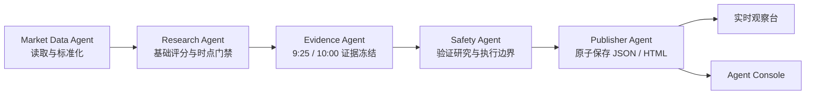

# Agent 架构

Dragon Research Agent 使用顺序式专职 Agent 管线。每个 Agent 只处理一个边界清晰的任务，共享 `AgentContext` 中的结构化对象，并由运行时生成可审计的 `AgentEvent`。



## 核心对象

- `AgentContext`：本次运行的帧、报告、配置、证据、连接摘要和产物路径。
- `AgentEvent`：Agent 名称、职责、状态、耗时、输入输出字段和不含敏感数据的摘要。
- `AgentPipeline`：按序执行；任一阶段失败就停止，不发布虚假的成功状态。

实现位于 `dragon_agent/agents/`。静态清单可通过以下命令导出：

```bash
./run.command agent-architecture
```

## 五个阶段

| Agent | 输入 | 输出 | 责任边界 |
| --- | --- | --- | --- |
| Market Data | provider/import | frame | 获取数据并验证帧版本 |
| Research | frame, config | report | 排序、时点与覆盖门禁 |
| V2 Evidence | frame, report, assessments | report.model_v2 | 冻结双阶段证据，缺失不补分 |
| Safety | report | safety_invariants | 强制研究输出不能成为订单 |
| Publisher | frame, report, connection | JSON, HTML | 原子发布报告与 Console |

Safety Agent 要求实时报告始终满足 `allow_entries=false`、`execution_ready=false`、`target_weight=0`，并保证 V2 否决项优先降级。这个边界使数据和评分层即使发生错误，也不能越过执行层。

## 扩展方法

实现包含 `name`、`role`、`inputs`、`outputs` 和 `run(context)` 的类，然后把它放到管线中的正确位置。Agent 应返回简短摘要，不在事件中写入密钥、原始响应或异常详情。参考 [`examples/custom_agent.py`](../examples/custom_agent.py)。

如果接入新的数据源，请先转换到现有 frame schema。若接入券商，必须建立独立的风控、幂等委托、回报对账和人工启用机制；当前仓库没有实盘订单路由。
